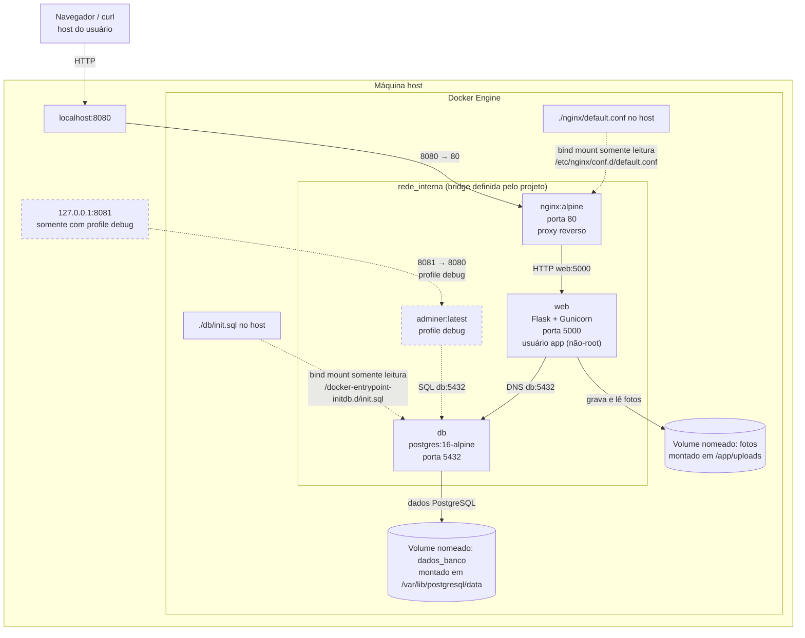

# Diagrama de arquitetura

## Dentro e fora da rede

| Componente | Acesso e posição |
| --- | --- |
| Navegador / `curl` | Fora da rede Docker; acessa a porta `8080` publicada pelo Nginx. |
| `nginx` | Dentro de `rede_interna`; único serviço que publica uma porta de aplicação no host (`8080:80`). |
| `web` | Dentro de `rede_interna`; não publica portas no host e aceita tráfego do Nginx na porta `5000`. |
| `db` | Dentro de `rede_interna`; não publica a porta `5432` no host. |
| `adminer` | Opcional, dentro de `rede_interna`; só inicia com `--profile debug` e a porta fica vinculada a `127.0.0.1:8081`. |
| Volumes nomeados | Recursos de armazenamento Docker, não pertencem à rede. |
| `db/init.sql` e `nginx/default.conf` | Arquivos do host montados como bind mounts somente leitura nos contêineres correspondentes. |

## Volumes e bind mounts

| Recurso | Tipo | Destino | Finalidade |
| --- | --- | --- | --- |
| `dados_banco` | Volume nomeado | `/var/lib/postgresql/data` em `db` | Persistir banco PostgreSQL. |
| `fotos` | Volume nomeado | `/app/uploads` em `web` | Persistir fotos enviadas. |
| `./db/init.sql` | Bind mount `:ro` | `/docker-entrypoint-initdb.d/init.sql` em `db` | Inicializar tabela e dados de exemplo quando o volume do banco está vazio. |
| `./nginx/default.conf` | Bind mount `:ro` | `/etc/nginx/conf.d/default.conf` em `nginx` | Configurar o proxy reverso e o limite de tamanho das requisições. |

## Portas

| Host | Contêiner | Serviço | Condição |
| --- | --- | --- | --- |
| `8080` | `80` | `nginx` | Publicada normalmente. |
| — | `5000` | `web` | Somente na rede interna. |
| — | `5432` | `db` | Somente na rede interna. |
| `127.0.0.1:8081` | `8080` | `adminer` | Somente com o profile `debug`. |
